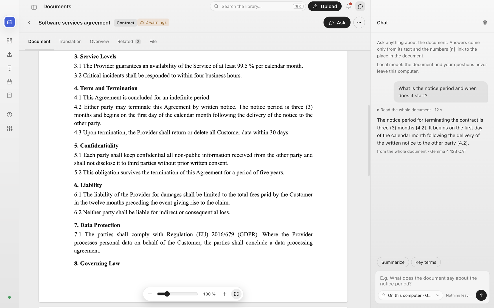
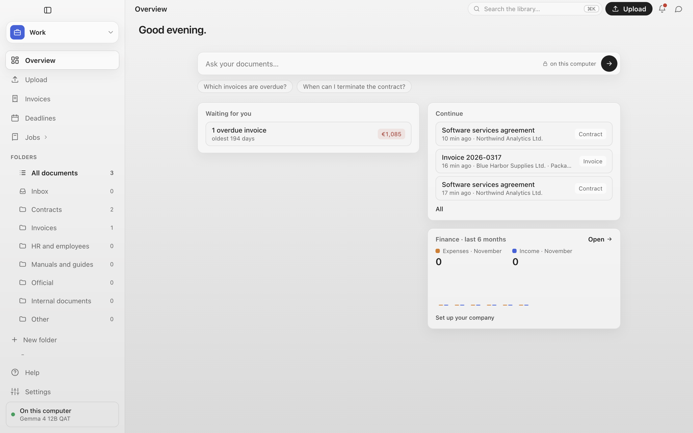
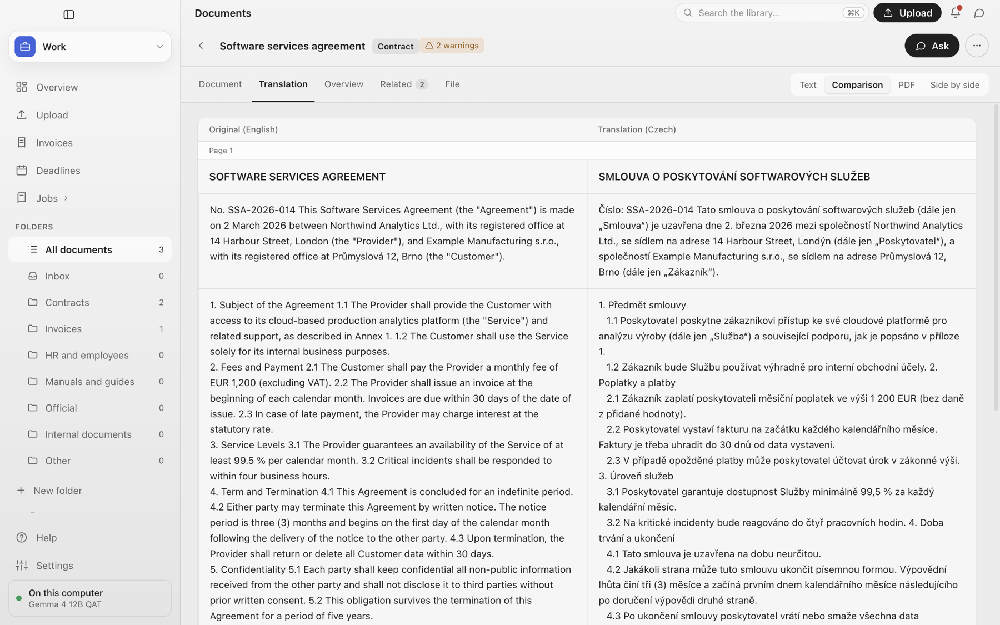

<p align="center"></p>

# Archa

**Translate your documents and ask them questions. Privately, on your own computer: no data leaves your machine.**

**Translate** a PDF (including scans), Word, TXT or Markdown file into a Word file, Markdown and a PDF that looks like the original. Then **ask about each document** on its own: you decide what to ask and get an answer **with sources** that highlight the exact passage. An AI model also describes each document and **files it into folders** for you. It runs **for free on your own computer** with a local model, so **nothing leaves your machine**: no cloud, no third party, no subscription. If you prefer, it works online through [OpenRouter](https://openrouter.ai) for a few cents.

> [!IMPORTANT]
> **Archa does not include an AI model.** Before you can upload, ask or translate you need one of these:
> - **Local (free, private):** install [LM Studio](https://lmstudio.ai) and download the models, see [Installation](#1-lm-studio-and-models-local-mode-only). Without LM Studio, local mode shows “LM Studio not found” and nothing is processed.
> - **Online:** an [OpenRouter API key](https://openrouter.ai/keys) with a little credit, pasted in **Settings**. No LM Studio needed.



## Who it is for

- **Anyone with a pile of documents:** contracts, letters, receipts, manuals, scans. Drop them in, ask *“When does my lease end?”* or *“What does this letter want from me?”* and jump straight to the place in the document. With local models, **your documents never leave the computer**.
- **Students and researchers:** read papers and books in a foreign language for (almost) nothing. See [For studying](#for-studying) below.
- **Small work use:** a Work library adds invoices, deadlines and contract checks when you need them.

### For studying

Writing a seminar paper or a thesis from foreign-language sources? Archa lets you work the way you actually study:

- **Translate as much as you need.** The whole document, only some pages (e.g. `12-30` of a book), only the paragraphs you tick, or just one chart or table: drag over it on the page and it is translated on the spot. Translate more later without starting over.
- **Ask instead of rereading.** *“What is the author's main argument?”*, *“How does the paper define human capital?”*, *“What method did they use and on what data?”*, *“What are the limitations?”* Every answer comes with sources and page numbers, so you can quote and cite correctly in your own work.
- **Summaries and key terms** with one click.
- **Learn the terminology.** The paragraph-by-paragraph comparison shows the original next to the translation.
- **For free and offline.** Locally it costs nothing and works without the internet, ideal for a student budget. Online, a whole article costs about half a crown.

> Archa helps you find and understand what a document says. It is not legal advice: always check important answers against the cited text.

## Why Archa

- **Private by design.** Local mode runs entirely on your computer. Translation, the document chat and all files stay on your disk.
- **Answers you can verify.** Every claim in a chat answer links to the paragraph it comes from; one click highlights it in both PDFs side by side.
- **Built for people on a budget.** Paid translators such as [DeepL Pro](https://www.deepl.com/pro) are monthly subscriptions, and document translation is limited on the cheaper plans. Archa has no subscription:
  - **Locally it costs nothing.** The models run on your computer.
  - **Online you pay only for what you use.** With the recommended model (DeepSeek V4.1 Flash) a 15–20-page article costs around **$0.02 (≈ 0.5 CZK)** to translate, and a question in the chat costs a fraction of a cent. A $10 OpenRouter credit is enough for hundreds of articles.
- **Made for academic and professional texts.** It keeps paragraphs, headings, footnotes, citations, links and tables, and fixes typical machine-translation errors.
- **You see what you'll pay.** The cost is estimated before you start (in USD, CZK or both) and the real cost is shown when the job finishes.

> Prices are approximate and depend on the model and the document; check current prices of paid services on their websites.

## Features

- **Upload:** drop PDFs (digital or scanned), Word, TXT or Markdown files; several at once, they are processed in the background.
- **Ask:** a chat with one document or your whole library. Answers come only from your documents, with numbered sources that highlight the passage in the original (and in the translation). You see what the model is doing, and quick actions **Summarize** and **Key terms** are one click away.
- **Sort:** AI describes every document and files it into folders; what it is unsure about waits in the inbox for you.
- **Private by design:** a local model keeps documents, questions and answers on your computer. Online models are optional.
- **Translate:** a translated PDF with the original layout, plus Word (.docx) and Markdown. Tables and figures can stay as in the original, and you can pick pages or paragraphs. Check and fix flags untranslated words and likely typos.
- **Read comfortably:** translation, paragraph-by-paragraph comparison, translated PDF, both PDFs side by side and the original, with zoom and area translation.
- **For the Work library:** invoices, deadlines and contracts.
- **Clean interface:** dark and light theme (or follow the system), Czech and English, macOS and Windows.

<table>
  <tr>
    <td></td>
    <td></td>
  </tr>
  <tr>
    <td align="center">Overview: ask your documents, what needs attention, sorted folders</td>
    <td align="center">Comparison of original and translation</td>
  </tr>
</table>

## How the document chat works

The chat uses **retrieval-augmented generation (RAG)**: the model answers from the document, not from its memory.

1. **Passages.** After translation the document is already split into paragraphs. Each one knows its page and its exact position on the page, in the original and in the translated PDF.
2. **Short document → whole text.** If the document fits into the model's context (about 10 pages locally, about 130 pages online), the model simply reads all of it. That is the most accurate option.
3. **Long document → search first.** The model turns your question into keywords in both languages (so you can ask in Czech about an English text). A full-text search (BM25 over the original and the translation, tolerant to Czech word endings) picks the most relevant paragraphs together with the heading of the section they belong to.
4. **Answer with sources.** The model gets only those passages and is told to answer strictly from them and cite each claim. Citations pointing to passages it was not given are removed automatically. If the answer is not in the document, it says so.
5. **Verify.** Click a source number and Archa opens the PDFs side by side and highlights the passage in both.

The conversation is stored with the job, so you can come back to it later.

## What you need

- **macOS** (Apple Silicon or Intel) or **Windows 10/11** (x64 or ARM).
- **Online mode only:** any such computer and an [OpenRouter](https://openrouter.ai) account with a little credit. No LM Studio and no powerful hardware needed.
- **Local mode:**
  - a Mac with 16 GB+ memory, or a PC with an 8 GB+ VRAM graphics card and 16 GB+ RAM (see [Hardware requirements](#hardware-requirements));
  - about 20 GB of free disk space for the models;
  - **LM Studio** with the models downloaded (see below).

## Hardware requirements

The models run on the GPU. Only one model is in memory at a time; the app swaps them as the translation moves through its stages. Each 12B model needs roughly 9–11 GB: the model file (7–8 GB) plus room for the context, because the app uses a 16k-token context and sends up to 4 requests at once.

| Computer | How it runs |
| --- | --- |
| Apple Silicon Mac with 24 GB+, PC with 16 GB+ VRAM | Recommended; the model fits entirely with room to spare. |
| Mac with 16 GB, PC with 12 GB VRAM and 16 GB RAM | Works. Avoid other heavy apps while translating. |
| PC with 8 GB VRAM and 16–32 GB RAM | Works, but slower; part of the model runs from RAM. |
| PC without a dedicated GPU, Mac with 8 GB | Not suitable. On the CPU alone a few pages take tens of minutes. |

- **Mac:** the GPU shares memory with the system and macOS gives it roughly two thirds to three quarters of it, so 16 GB is the minimum. Intel Macs with AMD graphics have not been tested.
- **Windows:** LM Studio splits the model between GPU and RAM on its own. If a model fails to load or the system becomes unusable, open the model settings in LM Studio (**My Models** → gear icon next to the model) and lower **GPU Offload**. Fewer layers on the GPU means less VRAM but slower translation.
- **Weaker and stronger machines:** TranslateGemma also comes in 4B (for 6–8 GB VRAM, lower quality) and 27B (for 24 GB VRAM, better quality). After downloading, select it in **Settings → Translation on this computer**. These sizes have not been tested with Archa yet.
- **Recommended on weaker computers: TranslateGemma 12B for translation + Gemma 4 E4B for fixes, context and chat** (search `gemma-4-e4b` in LM Studio and select it in **Settings**). Gemma only fixes flagged paragraphs, so the smaller model makes little difference there; in our first test E4B did as well as 12B, and it is faster. Archa keeps only one model in memory at a time, so the memory requirement is still set by the 12B translator.
- **When even that doesn't fit:** **TranslateGemma 4B** can handle simple, light texts (short letters, emails, instructions) or a quick idea of what a document says. On a demanding journal article it made roughly twice as many meaning errors and clearly worse Czech than 12B, so don't rely on it for texts that matter.

These requirements are estimates. They have been verified on a 16 GB Apple Silicon MacBook Air.

## Installation

### 1. LM Studio and models (local mode only)

1. Download and install LM Studio from <https://lmstudio.ai> and run it once.
2. Open the model search in LM Studio (magnifier icon on the left) and download these models:

   | Purpose | Model (search in LM Studio) | Variant | Size |
   | --- | --- | --- | --- |
   | Translation | `mradermacher/translategemma-12b-it-GGUF` | Q4_K_S | 7.8 GB |
   | Fixes, document context and tables | `google/gemma-4-12b-qat` | Q4_0 | 7.2 GB |
   | Page reading (OCR) | `sahilchachra/Unlimited-OCR-GGUF` | Q8_0 | 3.9 GB |

   For Fast mode on digital PDFs the first two are enough. The OCR model is needed for scans and for Balanced and Quality modes.
3. You don't need to load models or start the server yourself. Archa starts the server and loads models on its own, always only the one it currently needs.

### 2. Archa

Download the installer from [Releases](https://github.com/Molyn597/Archa/releases).

- **macOS:** `Archa-…-mac-universal.dmg`. Open it and drag Archa to Applications. The app is not signed with an Apple certificate, so the first time **right-click → Open** and confirm.
- **Windows:** `Archa-…-win.exe`. If Windows shows "Windows protected your PC", click **More info → Run anyway**. The app installs for your user only and creates a desktop shortcut.
- **Updating from TransLatte 0.2:** the update button in TransLatte can't download Archa (the repository was renamed). Close TransLatte, download the installer above and run it; it replaces TransLatte and keeps your documents. Later updates work from inside the app again.

### 3. First run

A short welcome guide asks whether AI should run on your computer or online and which **libraries** you want: **Work** (contracts, invoices, deadlines), **Study** (subjects, articles, study plan) and **Personal**. Each library has its own documents, folders, chat and optional password; you switch between them at the top of the left panel. For online mode paste your OpenRouter API key in **Settings** and you're done.

The connection status (LM Studio or OpenRouter and the active model) is shown at the bottom of the left panel; click it for details. In **Settings** each role (OCR, translation, fixes) has a model selected. If you downloaded the models from the table, everything is set. Change the server address (`http://localhost:1234`) only if LM Studio runs on another port or machine. The app language (Czech or English, by default following the system) can be changed in **Settings → Appearance**.

## How to use it

1. **Upload:** click **Upload** and drop files (PDF, scans, DOCX, TXT, MD) into the window. AI describes each document and files it into a folder; what it is unsure about waits in the **Inbox**.
2. **Ask:** open a document and click **Ask**, or ask the whole library from the **Overview**. Every answer comes with numbered sources from the document.
3. **Translate:** in the document click **Translate**, choose **where** (on your computer or online), check the **model** and the **languages**. Locally you can also pick the **quality** (Fast, Balanced, Best); online always uses the best mode. Optionally keep **tables and figures from the original**, **pick paragraphs** or translate **only some pages** (e.g. `1-5, 8`). Check the estimate and start.
4. The document detail has these tabs:
   - **Document**: the original; drag over a page to zoom into an area and translate just that part.
   - **Translation**: **Text**, **Comparison** (paragraph by paragraph), **PDF** (the translated PDF with the original layout) and **Side by side**.
   - **Overview**: summary, key facts and, for contracts, what to watch out for.
   - **Related** and **File**.

**Help** in the left panel explains everything in more detail.

### Quality (local mode)

| Quality | What it does | When to use |
| --- | --- | --- |
| **Fast** | Takes text straight from the PDF, OCR only for scanned pages. Only flags errors. | Ordinary digital PDFs; the default. |
| **Balanced** | OCR of all pages (better paragraph order and tables), checks and fixes errors. | Complex layouts, tables. |
| **Best** | Also reads the document context (topic, author and their grammatical gender) for more accurate fixes. | Texts that matter. |

## How translation works

1. **Extraction:** text and page layout (paragraphs, headings, tables, links) are read from the PDF. Headers, footers and page numbers are skipped. Scanned pages are read by the OCR model.
2. **Translation:** TranslateGemma (or the online model) translates paragraph by paragraph, several requests at once. Dates like `03-10-2014` are first rewritten into an unambiguous form so day and month don't get swapped.
3. **Check:** typical errors are found without a model: untranslated words, Czech prepositions (se/ze, ke/ve), spelling via a Hunspell dictionary, and truncated or repeated sentences. The Czech dictionary is downloaded on first use.
4. **Fix:** Gemma rewrites only the paragraphs with errors and leaves the rest alone.
5. **Output:** a Word file, Markdown and, for PDFs, a translated PDF. In it the original text is covered with the background colour, the translation is set in the same place and links stay clickable.

Documents, outputs and chat history are stored per library in the app folder:

- macOS: `~/Library/Application Support/Archa/libraries`
- Windows: `%APPDATA%\Archa\libraries`

Archa was previously called TransLatte. On the first start it moves the old `TransLatte` app folder to `Archa`, so your documents stay where they were. On macOS the online API key has to be entered again once, because the system keychain entry belongs to the old app name.

## Online models (OpenRouter)

Choose **Online** on the home screen and paste your [OpenRouter API key](https://openrouter.ai/keys) in **Settings**. The key is stored encrypted with the operating system's secure storage and is never written to the settings file.

- **Cost:** you pay only for what you translate, from your OpenRouter credit. Measured with DeepSeek V4.1 Flash: about $0.001 per page, i.e. roughly $0.02 for a 15–20-page article. The estimate is shown before you start and the real cost after the job; prices can be shown in USD, CZK or both.
- **Models:** in **Settings** pick a model from the OpenRouter catalog (with prices and a cost estimate per article; refresh the list any time). The default is `deepseek/deepseek-v4.1-flash` (best Czech in our comparison of eight cheap models); `google/gemini-3.1-flash-lite` is a faster alternative at about twice the price. Models ending in `:free` cost nothing but are slow (one request per ~3 s), have daily limits and the provider may use your data.
- **Privacy:** the text of your documents (and page images when OCR or table repair runs) is sent over the internet to the model provider. The same applies to the document chat when you choose an online model in it. Use local mode for sensitive documents.

## Troubleshooting

- **“LM Studio is not running and its “lms” command was not found”**: LM Studio is not installed or has never been started. Start it and try again.
- **“Could not load the model …”**: the model is not downloaded or doesn't fit in memory. Check in LM Studio that it is downloaded, close heavy apps, or lower GPU Offload (see [Hardware requirements](#hardware-requirements)).
- **Translation is slow or slows down over time:** laptops without active cooling throttle under long load. Plug in the charger and translate in smaller parts.
- **“The translation did not fit into the original space on page N”**: Czech text tends to be longer. The translated PDF uses a smaller font there or the text overflows; the full text is in the Word file.
- **Bullet points from web PDFs merge into one sentence:** a known limitation. Balanced mode with OCR helps.

## Development

```bash
npm install
npm start          # build and run from the project
npm test           # tests (no LLM needed)
npm run build      # build only
```

A release is created by pushing a tag matching the version in `package.json` (e.g. `v0.1.1`). GitHub Actions builds the macOS and Windows installers and publishes them.
